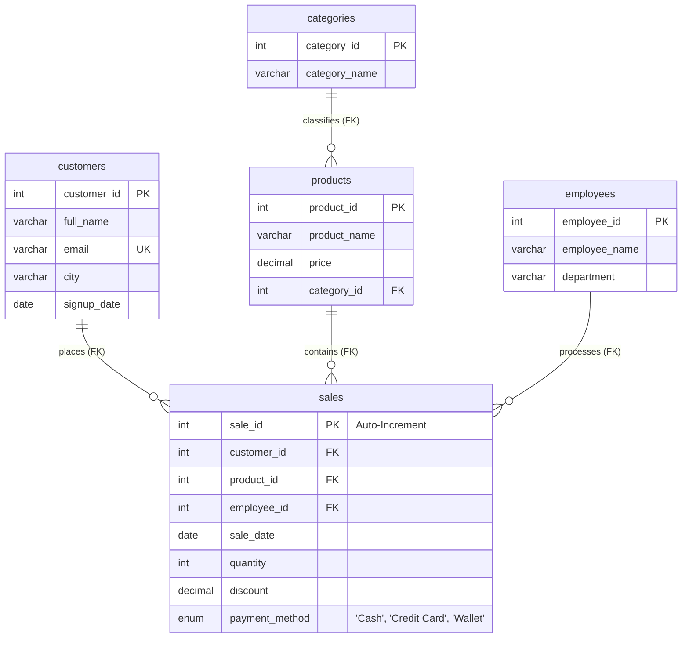

# 🌟 Enterprise Sales Star Schema Analytics & Window Functions (MySQL)

[](https://www.mysql.com/)
[]()
[]()
[]()
[](https://islamyasser424-design.github.io/portfolio-/)

> **A comprehensive Business Intelligence & Dimensional SQL project modeling an Enterprise Retail Data Warehouse (`Sales_Quiz`): architecting a 5-table Star Schema (Fact + 4 Dimensions), executing 15 analytical business queries, and implementing modern SQL Window Functions (`RANK()` and `SUM() OVER PARTITION BY`).**

---

## 📌 Table of Contents
- [✨ Project Architecture & Dimensional Model](#-project-architecture--dimensional-model)
- [📐 Star Schema Entity Relationship Diagram (ERD)](#-star-schema-entity-relationship-diagram-erd)
- [🏗️ Schema Structure & Data Dictionary](#️-schema-structure--data-dictionary)
- [🔍 15 Analytical Queries & Business Solutions](#-15-analytical-queries--business-solutions)
  - [Phase 1: Exploratory Filtering & Catalog Sorting (Q1 – Q2)](#phase-1-exploratory-filtering--catalog-sorting-q1--q2)
  - [Phase 2: Volume & Category Price Benchmarking (Q3 – Q5)](#phase-2-volume--category-price-benchmarking-q3--q5)
  - [Phase 3: Relational Joins & Financial Revenue Audits (Q6 – Q10)](#phase-3-relational-joins--financial-revenue-audits-q6--q10)
  - [Phase 4: Subqueries & Dynamic Threshold Auditing (Q11 – Q13)](#phase-4-subqueries--dynamic-threshold-auditing-q11--q13)
  - [Phase 5: Advanced Window Functions (Q14 – Q15)](#phase-5-advanced-window-functions-q14--q15)
- [💡 Deep Dive: Group By vs. Window Functions](#-deep-dive-group-by-vs-window-functions)
- [🚀 Execution Guide](#-execution-guide)
- [👤 Author & Connect](#-author--connect)

---

## ✨ Project Architecture & Dimensional Model

In modern data warehouse design, the **Star Schema** provides optimal query performance, simplified reporting joins, and intuitive analytical slicing for Power BI and SQL engines:
1. **Fact Table (`sales`):** Grain representing individual transactional checkout events (contains quantities, discounts, payment methods, and foreign surrogate keys).
2. **Dimension Tables:**
   - `dim_customers`: Geographic customer demographics (Cairo, Alexandria, Giza, etc.).
   - `dim_categories`: Product taxonomy (Electronics, Clothing, Books, Sports, Home & Garden).
   - `dim_products`: Merchandising SKU catalog with retail price points.
   - `dim_employees`: Sales workforce representatives and departmental assignment.

---

## 📐 Star Schema Entity Relationship Diagram (ERD)



---

## 🔍 15 Analytical Queries & Business Solutions

### Phase 1: Exploratory Filtering & Catalog Sorting (Q1 – Q2)

#### Q1: Regional Customer Extraction (Cairo)
```sql
SELECT customer_id, full_name, email, city, signup_date 
FROM customers 
WHERE city = 'Cairo';
```

#### Q2: High-Ticket Inventory Hierarchy (> $1,000)
```sql
SELECT product_id, product_name, price 
FROM products 
WHERE price > 1000.00 
ORDER BY price DESC;
```

---

### Phase 2: Volume & Category Price Benchmarking (Q3 – Q5)

#### Q3: System Transaction Volume & Order Quantity Spread
```sql
SELECT 
    COUNT(*) AS total_sales_records,
    MAX(quantity) AS maximum_quantity_sold,
    MIN(quantity) AS minimum_quantity_sold
FROM sales;
```

#### Q4: Product Velocity by Units Sold
```sql
SELECT 
    p.product_name,
    SUM(s.quantity) AS total_quantity_sold
FROM sales s
INNER JOIN products p ON p.product_id = s.product_id
GROUP BY p.product_name
ORDER BY total_quantity_sold DESC;
```

#### Q5: Category Price Benchmarking
```sql
SELECT 
    cat.category_name,
    ROUND(AVG(p.price), 2) AS average_product_price
FROM products p
INNER JOIN categories cat ON cat.category_id = p.category_id
GROUP BY cat.category_name
ORDER BY average_product_price DESC;
```

---

### Phase 3: Relational Joins & Financial Revenue Audits (Q6 – Q10)

#### Q6: Operational Transaction Logs (Multi-Table JOIN)
```sql
SELECT 
    c.full_name AS customer_name,
    p.product_name,
    s.quantity,
    s.sale_date,
    s.payment_method
FROM sales s
INNER JOIN products p ON s.product_id = p.product_id
INNER JOIN customers c ON s.customer_id = c.customer_id
ORDER BY s.sale_date DESC;
```

#### Q7 & Q8: SKU & Customer Gross Revenue ($\sum \text{Price} \times \text{Quantity}$)
```sql
-- Product Sales Valuation
SELECT 
    p.product_name,
    SUM(p.price * s.quantity) AS total_sales_revenue
FROM sales s
INNER JOIN products p ON s.product_id = p.product_id
GROUP BY p.product_name
ORDER BY total_sales_revenue DESC;

-- Customer Spend Audit
SELECT 
    c.full_name AS customer_name,
    SUM(p.price * s.quantity) AS total_amount_spent
FROM sales s
INNER JOIN products p ON s.product_id = p.product_id
INNER JOIN customers c ON s.customer_id = c.customer_id
GROUP BY c.full_name
ORDER BY total_amount_spent DESC;
```

#### Q9: High-Yield Category Threshold (`HAVING > 20,000`)
```sql
SELECT 
    cat.category_name,
    SUM(p.price * s.quantity) AS total_category_revenue
FROM sales s
INNER JOIN products p ON s.product_id = p.product_id
INNER JOIN categories cat ON p.category_id = cat.category_id
GROUP BY cat.category_name
HAVING SUM(p.price * s.quantity) > 20000.00
ORDER BY total_category_revenue DESC;
```

#### Q10: Employee Workload & Sales Productivity KPI
```sql
SELECT 
    e.employee_name,
    e.department,
    COUNT(s.sale_id) AS total_transactions_handled
FROM employees e
INNER JOIN sales s ON e.employee_id = s.employee_id
GROUP BY e.employee_id, e.employee_name, e.department
ORDER BY total_transactions_handled DESC;
```

---

### Phase 4: Subqueries & Dynamic Threshold Auditing (Q11 – Q13)

#### Q11: Dynamic Pricing Outliers (Scalar Subquery with AVG)
```sql
SELECT product_name, price
FROM products
WHERE price > (SELECT AVG(price) FROM products)
ORDER BY price DESC;
```

#### Q12: Active Customer Set Validation (`IN` Subquery)
```sql
SELECT customer_id, full_name, email, city
FROM customers
WHERE customer_id IN (SELECT DISTINCT customer_id FROM sales)
ORDER BY customer_id ASC;
```

#### Q13: Top-Tier Asset Buyer Identification (`MAX` Subquery)
```sql
SELECT DISTINCT c.full_name, c.email, p.product_name, p.price
FROM customers c
INNER JOIN sales s ON c.customer_id = s.customer_id
INNER JOIN products p ON s.product_id = p.product_id
WHERE p.price = (SELECT MAX(price) FROM products);
```

---

### Phase 5: Advanced Window Functions (Q14 – Q15)

#### Q14: Product Price Ranking via `RANK() OVER (ORDER BY price DESC)`
*Unlike `LIMIT`, Window Functions compute ranking partitions without collapsing rows, enabling top-N filtering with tie-awareness.*
```sql
SELECT 
    product_name,
    price,
    price_rank
FROM (
    SELECT 
        product_name,
        price,
        RANK() OVER (ORDER BY price DESC) AS price_rank
    FROM products
) AS ranked_catalog
WHERE price_rank <= 3;
```
##### Output:
| product_name | price | price_rank |
|:---|:---:|:---:|
| **Laptop Pro** | 18000.00 | **1** |
| **Smart TV 55** | 12000.00 | **2** |
| **Smartphone X** | 9500.00 | **3** |

---

#### Q15: Cumulative Customer Purchase Baseline (`SUM() OVER PARTITION BY`)
*Computes aggregate customer purchase benchmarks alongside detailed line-item transactions without collapsing rows into a GROUP BY.*
```sql
SELECT 
    c.full_name AS customer_name,
    s.sale_date,
    p.product_name,
    s.quantity AS transaction_units,
    SUM(s.quantity) OVER (PARTITION BY c.customer_id) AS total_customer_lifetime_units
FROM sales s
INNER JOIN customers c ON s.customer_id = c.customer_id
INNER JOIN products p ON s.product_id = p.product_id
ORDER BY c.full_name ASC, s.sale_date ASC;
```

---

## 💡 Deep Dive: Group By vs. Window Functions

```
Traditional GROUP BY:
[Row 1: Customer A, 2 Units] ──┐
[Row 2: Customer A, 3 Units] ──┼──> [Aggregated Row: Customer A, Total: 5 Units] (Details Lost)
[Row 3: Customer A, 1 Unit ] ──┘

Modern Window Function (OVER PARTITION BY):
[Row 1: Customer A, 2 Units, Lifetime: 6 Units] ✅ (Preserves Date & SKU Details)
[Row 2: Customer A, 3 Units, Lifetime: 6 Units] ✅ (Preserves Date & SKU Details)
[Row 3: Customer A, 1 Unit , Lifetime: 6 Units] ✅ (Preserves Date & SKU Details)
```

---

## 🚀 Execution Guide

```bash
# Clone the repository
git clone https://github.com/islamyasser424-design/SQL-Quiz-4.git
cd SQL-Quiz-4

# Execute complete DDL, DML, and 15-query analytical suite in MySQL
mysql -u root -p < SQL_Quiz_04_Enterprise_Sales_Analytics.sql
```

---

## 👤 Author & Connect

* **Author:** Islam Yasser — *Data Analyst & Business Intelligence Specialist*
* **Portfolio:** [islamyasser424-design.github.io/portfolio-/](https://islamyasser424-design.github.io/portfolio-/)
* **LinkedIn:** [linkedin.com/in/islam-yasser-55048b378](https://www.linkedin.com/in/islam-yasser-55048b378/)
* **GitHub:** [github.com/islamyasser424-design](https://github.com/islamyasser424-design)